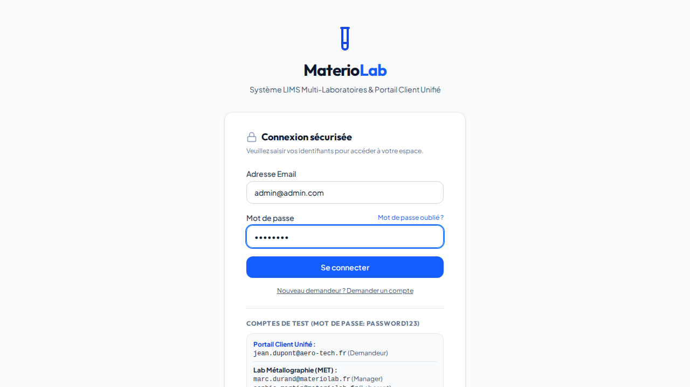
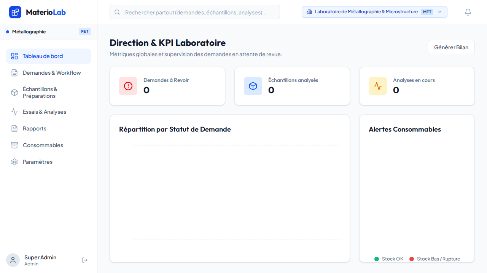
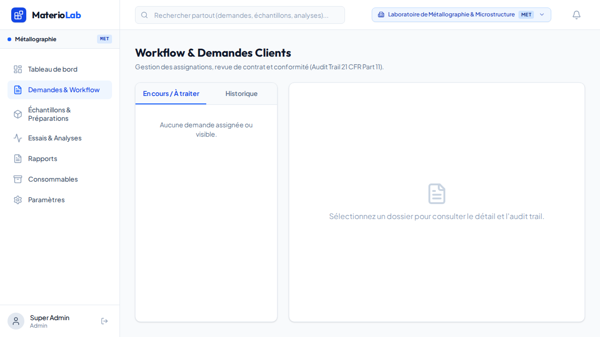
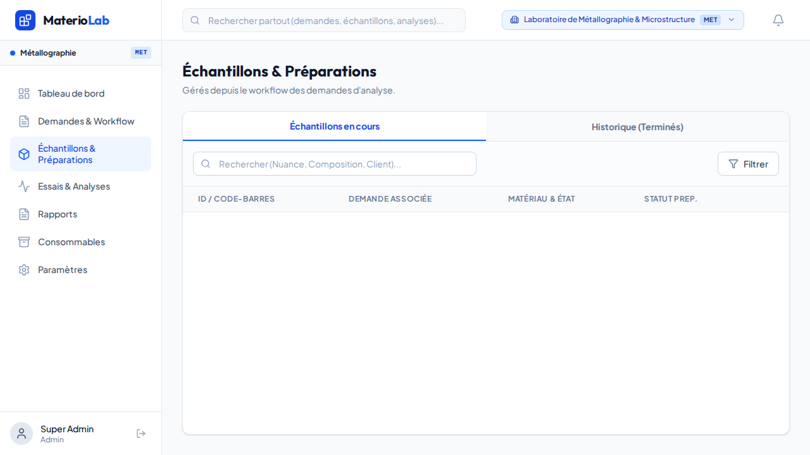
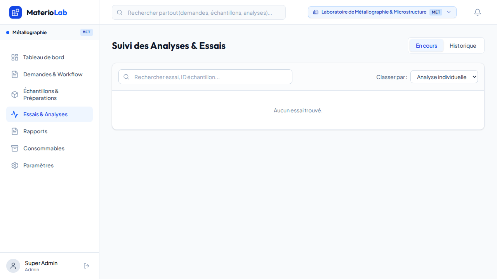
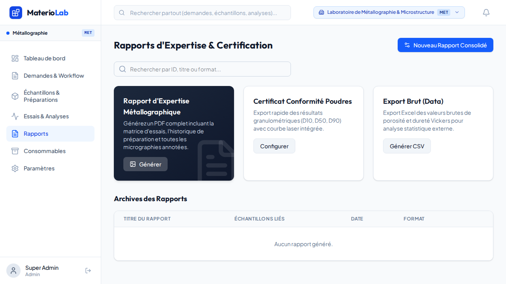

# Documentation LIMS (Laboratory Information Management System)

Bienvenue dans la documentation complète de l'application LIMS. Ce guide vous guidera à travers l'installation, la configuration et l'utilisation quotidienne de la plateforme.

## 1. Introduction

Ce LIMS a été conçu pour gérer efficacement les flux de travail au sein d'un ou plusieurs laboratoires. Il permet de :
- Gérer les demandes d'analyses (clients/demandeurs)
- Suivre les échantillons
- Saisir et valider les résultats d'analyses
- Générer des rapports personnalisables
- Gérer les utilisateurs et les laboratoires

## 2. Installation et Démarrage

### Prérequis
- [Node.js](https://nodejs.org/) (version 22 ou supérieure recommandée)
- [npm](https://www.npmjs.com/) ou [Bun](https://bun.sh/)

### Étapes d'installation

1. **Cloner le dépôt et installer les dépendances**
   ```bash
   # Utilisation de npm
   npm install

   # Ou avec Bun
   bun install
   ```

2. **Démarrer le serveur de développement**
   ```bash
   npm run dev &
   # ou bun run dev &
   ```

   Le serveur démarre généralement sur `http://localhost:3000` ou `http://localhost:5173`.

### Build pour la production

```bash
npm run build
npm run start &
```

## 3. Fonctionnalités et Utilisation

### 3.1. Page de connexion
L'accès à l'application est sécurisé et nécessite une authentification.


### 3.2. Tableau de bord (Dashboard)
Le tableau de bord offre une vue d'ensemble de l'activité du laboratoire :
- **KPIs** : Nombre de demandes, échantillons, analyses en attente.
- **Graphiques** : Répartition des statuts, évolution des demandes.


### 3.3. Gestion des Demandes (Requests)
- **Création** : Un demandeur peut créer une nouvelle demande en spécifiant les informations générales.
- **Suivi** : Les statuts permettent de suivre l'avancement (Brouillon, Soumise, En cours, Terminée).
- **Assignation** : Les managers peuvent assigner des demandes à des analystes spécifiques.


### 3.4. Gestion des Échantillons (Samples)
Chaque demande peut contenir plusieurs échantillons.
- **Réception** : Enregistrement de la réception physique.
- **Préparation** : Suivi des étapes de préparation (ex: montage, polissage).
- **Traçabilité** : Code unique pour chaque échantillon.


### 3.5. Analyses et Résultats
- **Saisie** : Les analystes saisissent les résultats des mesures.
- **Validation** : Processus de validation des résultats (ex: ISO 17025) par un manager.
- **Pièces jointes** : Ajout d'images ou de documents liés à l'analyse.


### 3.6. Génération de Rapports
- **Modèles** : Utilisation de modèles de rapports préconfigurés.
- **Génération PDF/Word** : Export automatique des résultats validés vers un format final.


## 4. Administration et Paramètres

### 4.1. Gestion des Utilisateurs
L'onglet Paramètres > Utilisateurs permet aux administrateurs de :
- **Créer des utilisateurs** : Définir le nom, l'email, le mot de passe provisoire et le rôle.
- **Rôles disponibles** :
  - `demandeur` : Client externe ou interne.
  - `analyste` : Technicien de laboratoire.
  - `manager` : Responsable de laboratoire.
  - `admin` : Administrateur système.
- **Attribution de Laboratoire** :
  - Les managers et analystes peuvent être affectés à un **laboratoire spécifique** ou à **tous les laboratoires** (Accès global).
  - Cela garantit qu'un manager ne voit et ne gère que les données de son périmètre.
- **Suppression** : Les administrateurs (`admin`) peuvent **supprimer un utilisateur** via le bouton corbeille rouge dans la liste.

### 4.2. Gestion des Laboratoires
- Création et modification des entités laboratoires.
- Définition des coordonnées et des spécificités de chaque site.

## 5. Sécurité et Accès
- Authentification par JWT (JSON Web Tokens).
- Base de données SQLite locale pour un déploiement simplifié.
- Les données sensibles (mots de passe) sont hachées avec bcrypt.

---
*Ce document évolue en fonction des mises à jour de l'application. N'hésitez pas à le compléter avec des captures d'écran de votre propre instance.*
