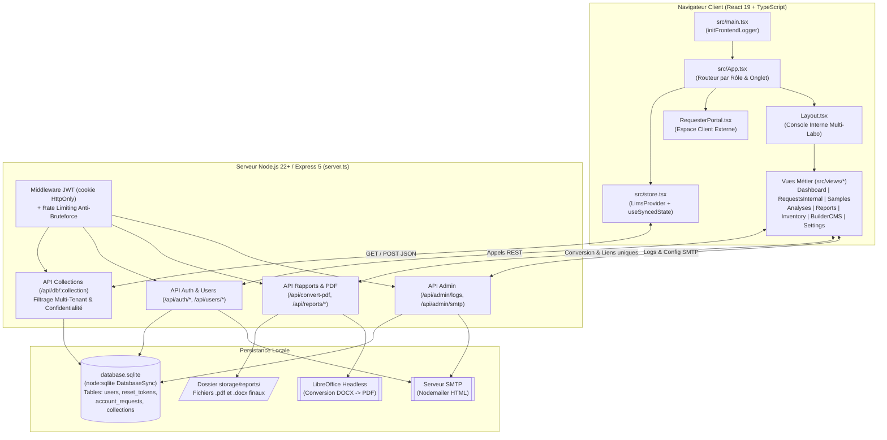
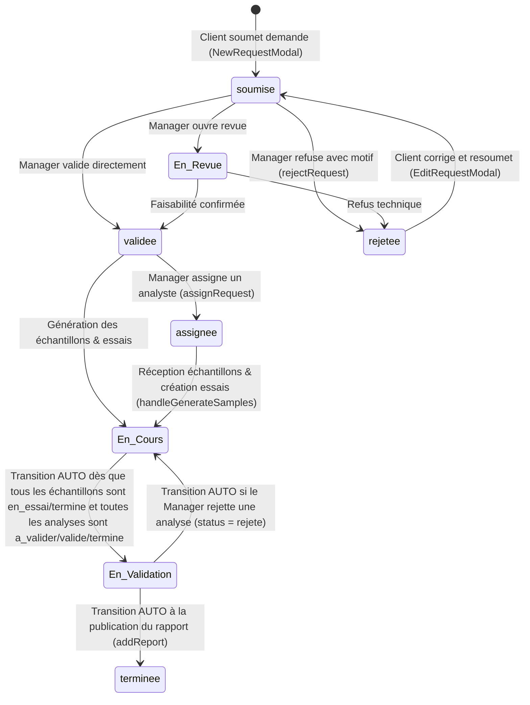

# Guide d'Architecture Développeur, Explication Complète du Code & Rapport d'Audit — LIMS Multi-Tenant

Ce document de référence a été conçu pour permettre à **n'importe quel développeur** (Junior, Senior, DevOps ou Auditeur Qualité ISO/IEC 17025) de :
1. **Comprendre rapidement l'architecture globale** (Frontend React 19, Store Multi-Tenant, Backend Express 5, Persistance SQLite hybride, Moteur OpenXML `.docx`/`.xlsx` et conversion PDF LibreOffice).
2. **Connaître le rôle exact de chaque fichier, composant, état et fonction** du projet.
3. **Savoir où chercher immédiatement en cas de bug** grâce au guide de diagnostic symptôme → fichier/ligne.
4. **Exploiter le rapport d'audit complet** (bugs corrigés lors de cet audit, bugs potentiels restants, cas limites, sécurité et pistes d'amélioration).

---

## Table des Matières

1. [Vue d'ensemble et Architecture Technique](#1-vue-densemble-et-architecture-technique)
2. [Modèle Multi-Tenant (Multi-Laboratoires) et Contrôle d'Accès (RBAC)](#2-modèle-multi-tenant-multi-laboratoires-et-contrôle-daccès-rbac)
3. [Flux de Données et Persistance SQLite Hybride](#3-flux-de-données-et-persistance-sqlite-hybride)
4. [Cycles de Vie Métier (Demandes, Échantillons, Analyses, Rapports)](#4-cycles-de-vie-métier-demandes-échantillons-analyses-rapports)
5. [Explication Détaillée Fichier par Fichier](#5-explication-détaillée-fichier-par-fichier)
   - [5.1 Serveur Backend & Base de Données (`server.ts`, `src/db/*`)](#51-serveur-backend--base-de-données-serverts-srcdb)
   - [5.2 Cœur Applicatif Frontend (`src/types.ts`, `src/data.ts`, `src/store.tsx`, `src/App.tsx`, `src/main.tsx`)](#52-cœur-applicatif-frontend-srctypests-srcdatats-srcstoretsx-srcapptsx-srcmaintsx)
   - [5.3 Utilitaires Techniques (`src/utils/*`)](#53-utilitaires-techniques-srcutils)
   - [5.4 Composants Partagés & Modales (`src/components/*`)](#54-composants-partagés--modales-srccomponents)
   - [5.5 Vues Métier (`src/views/*`)](#55-vues-métier-srcviews)
6. [Guide de Dépannage Rapide (« Où chercher en cas de bug ? »)](#6-guide-de-dépannage-rapide--où-chercher-en-cas-de-bug-)
7. [Rapport d'Audit de Code Complet](#7-rapport-daudit-de-code-complet)
   - [7.1 Bugs & Failles Corrigés Directement lors de cet Audit](#71-bugs--failles-corrigés-directement-lors-de-cet-audit)
   - [7.2 Bugs Potentiels, Cas Limites et Incohérences Identifiés par Fichier](#72-bugs-potentiels-cas-limites-et-incohérences-identifiés-par-fichier)
   - [7.3 Audit de Sécurité & Conformité ISO/IEC 17025](#73-audit-de-sécurité--conformité-isoiec-17025)

---

## 1. Vue d'ensemble et Architecture Technique

L'application **LIMS Multi-Tenant** est un système de gestion de l'information de laboratoire (*Laboratory Information Management System*) orienté science des matériaux (Métallographie, Microstructure, Essais Mécaniques, Physico-Chimie et Poudres) et conçu autour des exigences de traçabilité de la norme **ISO/IEC 17025**.

### Stack technologique
- **Runtime** : Node.js >= 22 (utilise le module natif synchrone `node:sqlite` — aucune compilation C++ type `better-sqlite3` requise).
- **Serveur Backend (`server.ts`)** : Express 5, authentification JWT par cookie `HttpOnly`, hachage `bcryptjs`, envoi d'e-mails transactionnels `nodemailer`, conversion Word → PDF via `libreoffice-convert`.
- **Frontend (`src/`)** : React 19, TypeScript 5.8, Vite 6, Tailwind CSS 4, icônes `lucide-react`, graphiques `recharts`.
- **Moteurs documentaires embarqués** :
  - **Word (`.docx`)** : `pizzip` + `docxtemplater` + `docxtemplater-image-module-free` + injection directe de tableaux OpenXML (`<w:tbl>`).
  - **PDF** : Double moteur — soit conversion serveur fidèle d'un `.docx` via LibreOffice + rendu `react-pdf` (`pdfjs-dist`), soit capture DOM paginée via `dom-to-image-more` + `jspdf`.
  - **Excel (`.xlsx`)** : Générateur OpenXML et archiveur ZIP/CRC32 écrit **100 % nativement** dans `src/views/Dashboard.tsx` (génère un classeur multi-feuilles avec graphiques natifs DrawingML sans bibliothèque tierce).
  - **Étiquettes Thermiques Zebra (70×37 mm)** : Génération locale de QR Codes (`qrcode`) + impression CSS calibrée ou code natif **ZPL II** (`^XA...^XZ` à 203 dpi).

---

## 2. Modèle Multi-Tenant (Multi-Laboratoires) et Contrôle d'Accès (RBAC)

Le système repose sur deux dimensions de cloisonnement : **le rôle utilisateur (`Role`)** et **le périmètre laboratoire (`labId`)**.

### 2.1 Les 4 rôles (`Role` dans [`src/types.ts`](/src/types.ts#L52))

| Rôle | Interface affichée (`App.tsx`) | Périmètre `labId` | Droits principaux |
|---|---|---|---|
| **`demandeur`** | `RequesterPortal.tsx` (et `Settings.tsx` onglet Sécurité) | Transversal (peut adresser ses demandes à n'importe quel laboratoire) | Créer/dupliquer des demandes, corriger/resoumettre une demande rejetée, suivre l'avancement, télécharger ses rapports via lien à usage unique. |
| **`analyste`** | `Layout.tsx` + Vues opérationnelles (`Dashboard` vue opérateur, `RequestsInternal`, `Samples`, `Analyses`, `Reports`, `Inventory`, `Settings` profil) | Fixé à un laboratoire (ex: `lab-metallurgie`) ou `'all'` | Voir les demandes qui lui sont assignées, réceptionner/découper les échantillons, saisir les résultats d'analyses, soumettre pour validation (`a_valider`), gérer les stocks. |
| **`manager`** | `Layout.tsx` + Toutes les vues internes + **`BuilderCMS.tsx`** | Fixé à son laboratoire ou `'all'` | Tout ce que fait l'analyste + valider/rejeter les demandes et les analyses, assigner un analyste, configurer les modèles CMS (Matériaux, Analyses, Formulaires, Rapports), gérer les utilisateurs de son labo. |
| **`admin`** | `Layout.tsx` + Toutes les vues + Administration système complète | `'all'` (accès multi-laboratoires complet) | Tout ce que fait le manager + créer/modifier/supprimer des laboratoires, supprimer des comptes utilisateurs, configurer et tester le serveur SMTP, consulter/purger les logs Frontend & Backend. |

### 2.2 Cloisonnement Multi-Tenant (Client + Serveur)
1. **Côté Frontend ([`src/store.tsx`](/src/store.tsx))** :
   - Le store maintient les collections complètes (`rawRequests`, `rawSamples`, `rawAnalyses`, etc. exposées sous `allRequests`, `allSamples`, etc.) ET expose des vues filtrées mémoïsées (`requests`, `samples`, `analyses`, `reports`, `consumables`, `materialTemplates`, etc.) selon `activeLabId` (pour le personnel interne) ou `currentUser.id` (pour un `demandeur`).
2. **Côté Backend ([`server.ts`](/server.ts#L708-L824))** :
   - Sur `GET /api/db/:collection` : si `req.user.role === 'demandeur'`, le serveur filtre les données avant envoi HTTP pour ne retourner que les demandes, échantillons, analyses, rapports et notifications appartenant à ce demandeur (et renvoie `[]` pour `consumables`).
   - Sur `POST /api/db/:collection` :
     - Si l'utilisateur est un `demandeur`, seules les collections `requests` et `notifications` sont modifiables. Le serveur fusionne (`merge`) uniquement les éléments dont `requesterId === user.id` avec les éléments existants des autres clients, et interdit au demandeur de forcer un statut autre que `'soumise'`.
     - Si l'utilisateur est un `analyste` ou `manager` rattaché à un laboratoire spécifique (`user.labId !== 'all'`), le serveur préserve en base toutes les entrées appartenant aux autres laboratoires (`otherLabsData`) et ne remplace que les entrées de `user.labId`.

---

## 3. Flux de Données et Persistance SQLite Hybride

La base de données SQLite (`database.sqlite` à la racine du projet) est gérée de manière synchrone via `DatabaseSync` (`node:sqlite`) et combine :

1. **Trois tables relationnelles classiques pour la sécurité ([`src/db/auth.ts`](/src/db/auth.ts))** :
   - `users (id PRIMARY KEY, email UNIQUE, passwordHash, name, role, company, labId)`
   - `reset_tokens (email PRIMARY KEY, token, expiry)`
   - `account_requests (id PRIMARY KEY, name, email, company, message, created_at)`
2. **Une table clé-valeur documentaire JSON pour les entités métier ([`src/db/lims.ts`](/src/db/lims.ts))** :
   - `collections (id TEXT PRIMARY KEY, data TEXT NOT NULL)`
   - Les clés (`id`) autorisées dans `collections` sont : `laboratories`, `notifications`, `materialTemplates`, `analysisTemplates`, `requestTemplates`, `reportTemplates`, `samples`, `analyses`, `materials`, `reports`, `requests`, `consumables`, ainsi que `smtpSettings` (gérée exclusivement par les routes `/api/admin/smtp`).

### Fonctionnement du hook `useSyncedState` ([`src/store.tsx`](/src/store.tsx#L194-L231))
- Tant que l'utilisateur n'est pas authentifié (`isAuthenticated === false`), l'état en mémoire contient les données initiales de [`src/data.ts`](/src/data.ts).
- Dès que `isAuthenticated` passe à `true`, un `useEffect` appelle `GET /api/db/:collection`.
  - Si la ligne existe dans la table `collections`, React charge ce tableau.
  - Si la ligne vaut `null` (base neuve au premier démarrage), le client envoie automatiquement `initialData` via `POST /api/db/:collection` pour initialiser la base.
- Chaque mutation métier (`addRequest`, `updateSampleStatus`, `updateAnalysisResult`, etc.) appelle `setSyncedData`, qui met à jour l'état React immédiatement (rendu optimiste) et envoie le tableau complet mis à jour via `POST /api/db/:collection`.

---

## 4. Cycles de Vie Métier (Demandes, Échantillons, Analyses, Rapports)

### Règles d'automatisation importantes à connaître (implémentées dans [`src/store.tsx`](/src/store.tsx))
1. **Propagation de l'assignation (`assignRequest`, L.673-713)** :
   - Assigner un analyste à une demande passe la demande au statut `'assignee'`, notifie l'analyste et le client, et met à jour le champ `technician` de toutes les analyses déjà rattachées aux échantillons de cette demande.
2. **Passage automatique de la demande en `'En Validation'` (`updateAnalysisStatus`, L.829-860)** :
   - Lorsqu'une analyse passe à `'a_valider'`, `'valide'` ou `'termine'`, le store vérifie tous les échantillons (et sous-échantillons) de la demande parente :
     - Si tous les échantillons ont `status` dans `['en_essai', 'termine', 'non_conforme']`,
     - ET que toutes les analyses rattachées ont `status` dans `['a_valider', 'valide', 'termine']`,
     - Alors la demande parente passe automatiquement à `'En Validation'`.
3. **Réouverture automatique en cas de rejet d'analyse (`updateAnalysisStatus`, L.795-812)** :
   - Si le manager rejette une analyse (`status = 'rejete'`), l'analyste assigné reçoit une notification avec le motif, et si la demande parente était `'En Validation'`, elle repasse automatiquement à `'En Cours'`.
4. **Verrouillage des résultats d'analyses (`updateAnalysisResult`, L.868-897)** :
   - Un `analyste` ne peut plus modifier les résultats d'une analyse dès qu'elle est au statut `'a_valider'`, `'valide'` ou `'termine'` (sauf si le manager la repasse en `'rejete'` ou `'En Cours'`).
   - Un `manager` ou `admin` peut encore corriger un résultat en `'a_valider'` ou `'valide'`, mais plus en `'termine'`.
5. **Clôture automatique à la génération du rapport (`addReport`, L.917-959)** :
   - L'ajout d'un rapport résout automatiquement `requestId` (via les échantillons liés s'il n'est pas fourni), passe la demande parente au statut `'terminee'` et notifie le client par e-mail et in-app.

---

## 5. Explication Détaillée Fichier par Fichier

### 5.1 Serveur Backend & Base de Données (`server.ts`, `src/db/*`)

#### [`server.ts`](/server.ts)
- **Lignes 40–116 (`recordServerLog`, surcharge `console.*`)** : Intercepte tous les appels `console.log/info/warn/error` côté serveur et les stocke dans le tampon circulaire `serverLogs` (max 500 entrées) exposé aux administrateurs via `GET /api/admin/logs`.
- **Lignes 122–443 (`getSmtpConfig`, `buildHtmlEmailTemplate`, `sendMailViaSmtp`)** : Lit la configuration SMTP depuis la collection SQLite `smtpSettings`, construit un e-mail HTML responsive sécurisé (`escapeHtml`) et l'envoie via `nodemailer`.
- **Lignes 499–542 (`checkRateLimit`, `authenticate`)** :
  - `checkRateLimit(key, maxAttempts, windowMs)` : Limiteur de débit en mémoire par IP pour protéger `/api/auth/login` (10 essais / 15 min), `/api/auth/forgot-password` (5 / 15 min), `/api/auth/reset-password` (10 / 15 min) et `/api/auth/request-account` (5 / 60 min).
  - `authenticate` : Vérifie le cookie `token` via `jwt.verify` et recharge systématiquement l'utilisateur en base (`getUserById`) pour prendre en compte immédiatement toute révocation ou changement de rôle.
- **Lignes 579–707 (Routes Admin & SMTP)** :
  - `GET / DELETE /api/admin/logs` : Consultation et purge des logs backend (`admin` uniquement).
  - `GET / POST /api/admin/smtp` et `POST /api/admin/smtp/test` : Lecture (avec mot de passe masqué `'••••••••'`), sauvegarde et test de connexion SMTP.
  - `POST /api/notifications/send-email` : Envoi d'e-mail déclenché par `addNotification` côté client.
- **Lignes 713–839 (`GET / POST /api/db/:collection`)** : API générique des collections avec contrôle de liste blanche (`ALLOWED_COLLECTIONS`), protection des modèles CMS (`MANAGER_ONLY_COLLECTIONS`) et isolation des données par `role` et `labId`.
- **Lignes 845–1160 (Authentification, Utilisateurs, Mots de passe, Demandes de compte)** :
  - `POST /api/auth/login`, `POST /api/auth/logout`, `GET /api/auth/me`.
  - `GET / POST / DELETE /api/users` : Gestion des comptes avec restriction de création par laboratoire pour les managers.
  - `POST /api/auth/change-password`, `POST /api/auth/forgot-password`, `POST /api/auth/reset-password` (avec révocation automatique du code OTP à 6 chiffres au bout de 3 tentatives erronées via `otpFailedAttempts`).
  - `POST /api/auth/request-account`, `GET / DELETE /api/users/requests` : Workflow d'inscription validé par un manager.
- **Lignes 1166–1229 (`POST /api/convert-pdf`, `GET /api/temp-pdf/:id`)** :
  - Vérifie la signature magique ZIP (`0x50 0x4B` = `PK`) et la taille (< 15 Mo) du buffer DOCX, limite la concurrence à `MAX_CONCURRENT_CONVERSIONS = 2`, convertit le document via LibreOffice (`libreConvertAsync`) et garde le PDF en cache mémoire (`tempPdfs`) pendant 1 heure avec contrôle d'accès propriétaire/laboratoire.
- **Lignes 1235–1467 (Stockage physique des rapports & Liens à usage unique)** :
  - `POST /api/reports/upload` : Écrit le fichier `.pdf` ou `.docx` dans `storage/reports/<safeReportId>.<ext>` et met à jour `storedFileName` dans la collection `reports`.
  - `POST /api/reports/:id/generate-link` et `POST /api/reports/by-request/:requestId/generate-link` : Vérifient les droits d'accès (notamment qu'un `demandeur` est bien l'auteur de la demande) et génèrent un jeton aléatoire de 32 octets (`oneTimeDownloadTokens`) valable **2 minutes** et **un seul téléchargement**.
  - `GET /api/reports/download/:token` : Supprime immédiatement le jeton (`oneTimeDownloadTokens.delete(token)`), vérifie que `tokenData.userId === req.user.id`, et streame le fichier avec `Cache-Control: no-store`.

#### [`src/db/auth.ts`](/src/db/auth.ts) & [`src/db/lims.ts`](/src/db/lims.ts)
- `auth.ts` : Singleton `getDb()` ouvrant `./database.sqlite`, initialisation des tables `users`, `reset_tokens`, `account_requests`, et fonctions CRUD préparées (`getUserByEmail`, `getUserById`, `createUser`, `getUsers`, `updatePassword`, `deleteUser`, `createResetToken`, `getResetToken`, `deleteResetToken`, `createAccountRequest`, `getAccountRequests`, `deleteAccountRequest`).
- `lims.ts` : Table `collections (id, data)` et accesseurs `getCollection(id)` (`JSON.parse`) / `setCollection(id, data)` (`JSON.stringify`).

---

### 5.2 Cœur Applicatif Frontend (`src/types.ts`, `src/data.ts`, `src/store.tsx`, `src/App.tsx`, `src/main.tsx`)

- **[`src/types.ts`](/src/types.ts)** : Définit l'intégralité du modèle de domaine TypeScript (`SampleStatus`, `AnalysisStatus`, `RequestStatus`, `Role`, `Laboratory`, `Consumable`, `User`, `AuditLog`, `Notification`, `CustomField`, `MaterialTemplate`, `ExpectedResult`, `AnalysisTemplate`, `RequestTemplate`, `AnalysisRequest`, `MountingInfo`, `Sample`, `Analysis`, `LabSettings`, `Report`, `ReportTemplate`).
- **[`src/data.ts`](/src/data.ts)** : Contient le jeu de données initiales pour 2 laboratoires complets :
  1. `lab-metallurgie` (Code `MET`, thème bleu) : Métallographie, microdureté Vickers, taille de grains, brouillard salin.
  2. `lab-mecanique` (Code `MEC`, thème émeraude) : Traction, résilience Charpy, granulométrie laser, BET, pycnométrie Hélium, dosage C/S.
- **[`src/store.tsx`](/src/store.tsx)** : Contexte React `LimsProvider` et hook `useLims()` centralisant l'état, le filtrage multi-laboratoires, les actions métier, la génération de la piste d'audit et le déclenchement des notifications.
- **[`src/App.tsx`](/src/App.tsx)** : Routeur d'affichage sans dépendance `react-router` :
  - Non connecté → `<Login />`
  - Connecté avec `role === 'demandeur'` → `<RequesterPortal />` (ou `<Settings />` pour son mot de passe) + bouton flottant de déconnexion.
  - Connecté en interne (`analyste`, `manager`, `admin`) → `<Layout>` englobant la vue sélectionnée par `activeTab` (`dashboard`, `requests`, `samples`, `analyses`, `reports`, `inventory`, `builder`, `settings`).
- **[`src/main.tsx`](/src/main.tsx)** : Initialise le collecteur de logs frontend (`initFrontendLogger()`) avant de monter `<App />` dans `#root`.

---

### 5.3 Utilitaires Techniques (`src/utils/*`)

- **[`src/utils/colors.ts`](/src/utils/colors.ts)** : Palette `LAB_COLORS` (6 thèmes Tailwind complets : bleu, émeraude, violet, ambre, rose, cyan) et fonction `getLabColor(index)` pour colorer dynamiquement l'interface selon le laboratoire actif.
- **[`src/utils/docxImageModule.ts`](/src/utils/docxImageModule.ts)** : Configure `docxtemplater-image-module-free` :
  - `decodeDataUrl` : convertit une DataURL base64 en `Uint8Array`.
  - `readDimensions` : lit directement les octets d'en-tête **PNG** (chunk `IHDR` aux offsets 16 et 20) et **JPEG** (marqueurs `SOF0..SOF15`) pour calculer un redimensionnement proportionnel (max 420×300 pt) sans recourir au DOM asynchrone.
- **[`src/utils/idGenerator.ts`](/src/utils/idGenerator.ts)** :
  - `generateUniqueLimsId(prefix, existingIds, codeLength)` : Génère des identifiants sans collision au format `PREFIX-AA-XXXXX` (ex: `ECH-MET-26-K8F3M`) sur un alphabet Base32 Crockford sans caractères ambigus (`0, O, 1, I, L`).
  - `generateUniqueBarcode(existingBarcodes, prefix)` : Génère des codes-barres uniques `PREFIX-AA-NNNNNN` avec `crypto.getRandomValues`.
- **[`src/utils/logger.ts`](/src/utils/logger.ts)** : Intercepte `console.log/info/warn/error`, `window.onerror` et `unhandledrejection` côté navigateur et notifie en temps réel l'onglet "Logs Système" de `Settings.tsx` via `subscribeFrontendLogs`.
- **[`src/utils/zebraLabelPrinter.ts`](/src/utils/zebraLabelPrinter.ts)** :
  - `generateZplForSamples(items)` : Génère le code natif ZPL II (`^XA ^CI28 ^PW560 ^LL296 ... ^XZ`) pour étiquettes 70×37 mm à 203 dpi avec QR Code (`^BQN,2,5`).
  - `printZebraLabelsWindow(items)` : Génère les QR codes localement en Base64 via `QRCode.toDataURL` et ouvre une fenêtre d'impression HTML/CSS calibrée (`@page { size: 70mm 37mm; margin: 0; }`).

---

### 5.4 Composants Partagés & Modales (`src/components/*`)

- **[`src/components/Layout.tsx`](/src/components/Layout.tsx)** :
  - Barre latérale de navigation, sélecteur de laboratoire actif (Multi-Tenant), barre de recherche globale (`globalSearchQuery`) et centre de notifications intelligent (`handleNotificationClick` qui bascule automatiquement sur le bon laboratoire, le bon onglet et pré-filtre l'identifiant ciblé).
  - Polling toutes les 15s sur `GET /api/users/requests` pour alerter les managers des nouvelles demandes d'ouverture de compte.
- **[`src/components/NewRequestModal.tsx`](/src/components/NewRequestModal.tsx)** :
  - Formulaire modal en 3 étapes (Choix du laboratoire → Choix du modèle de formulaire → Saisie des champs dynamiques CMS, incluant la sélection des essais `analyses` et des matériaux `materials` avec leurs sous-propriétés `${field.id}__material_properties`). Supporte aussi la duplication d'une demande existante via la prop `initialRequest`.
- **[`src/components/EditRequestModal.tsx`](/src/components/EditRequestModal.tsx)** :
  - Permet au demandeur de consulter sa demande en lecture seule, ou de modifier et resoumettre (`resubmitRequest`) une demande ayant le statut `'rejetee'` ou `'brouillon'`.
- **[`src/components/NewSampleModal.tsx`](/src/components/NewSampleModal.tsx)** :
  - Enregistrement manuel d'un échantillon hors demande (ou rattaché au laboratoire actif) avec choix du modèle de matériau et saisie de ses caractéristiques dynamiques.
- **[`src/components/PdfViewer.tsx`](/src/components/PdfViewer.tsx)** :
  - Wrapper autour de `react-pdf` (`Document` / `Page`) configurant le Web Worker `pdfjs-dist` pour afficher toutes les pages d'un PDF dans la modale d'aperçu.
- **[`src/components/ReportPreviewModal.tsx`](/src/components/ReportPreviewModal.tsx)** :
  - Moteur bi-mode de génération et d'aperçu des rapports :
    1. **Mode Word `.docx`** : Prépare toutes les balises et tableaux OpenXML (`getDocData`), fusionne avec `Docxtemplater`, convertit en PDF via `POST /api/convert-pdf` et archive sur le serveur via `POST /api/reports/upload`.
    2. **Mode HTML A4 Standard** : Rend une feuille A4 structurée en blocs `.pdf-block` et les capture via `dom-to-image-more` + `jsPDF` (`buildPdfFromHtmlPreview`) sans jamais couper un tableau ou une micrographie entre deux pages.

---

### 5.5 Vues Métier (`src/views/*`)

- **[`src/views/Login.tsx`](/src/views/Login.tsx)** :
  - Gère 4 modes (`'login'`, `'forgot'`, `'reset'`, `'request'`) pour l'authentification, la récupération de mot de passe par code OTP à 6 chiffres et la demande d'ouverture de compte client.
- **[`src/views/RequesterPortal.tsx`](/src/views/RequesterPortal.tsx)** :
  - Portail dédié aux demandeurs : cartes de filtrage par laboratoire, liste des demandes avec statuts traduits côté client, consultation des motifs de refus, duplication en un clic et téléchargement sécurisé des rapports finaux (`handleDownloadRequestReport`).
- **[`src/views/Dashboard.tsx`](/src/views/Dashboard.tsx)** :
  - **Vue Analyste** : Mes demandes assignées, mes analyses en cours, échantillons en attente et modale d'aperçu rapide.
  - **Vue Manager / Admin** : KPI opérationnels et qualité ISO 17025 (taux de clôture, demandes en retard selon SLA par priorité, essais en attente de validation, alertes stocks/péremption), graphiques Recharts, **Générateur de Bilan PDF** (`generateBilanPDF`) et **Générateur natif de classeur Excel `.xlsx` multi-feuilles avec graphiques DrawingML** (`generateExcelDashboard`).
- **[`src/views/RequestsInternal.tsx`](/src/views/RequestsInternal.tsx)** :
  - Console interne de gestion des demandes : filtrage Actives / Historique, validation ou rejet avec motif, assignation à un analyste, édition manager des données de la demande, **génération automatique en lot des échantillons et des fiches d'analyses** (`handleGenerateSamples`) à partir des prestations cochées par le client, et impression des étiquettes Zebra.
- **[`src/views/Samples.tsx`](/src/views/Samples.tsx)** :
  - Gestion des échantillons : recherche par code-barres/douchette, stepper de progression (`receptionne` → `en_preparation` → `en_essai` → `termine` / `non_conforme`), fiche de préparation métallographique (`mountingInfo`), **découpe en sous-échantillons / plots d'enrobage** (`ENR-...`), et impression d'étiquettes Zebra individuelles ou par lot.
- **[`src/views/Analyses.tsx`](/src/views/Analyses.tsx)** :
  - Saisie des résultats d'essais selon la définition dynamique de l'`AnalysisTemplate` :
    - `number_series` : calcul temps réel de la moyenne et de l'écart-type ($s$, correction de Bessel $n-1$).
    - `vertical_table` : tableau multi-colonnes avec **import CSV/TSV et collage direct depuis Microsoft Excel** (`parseAndMergeVerticalTableText`).
    - `micrography` : galerie de clichés redimensionnés/compressés côté client (`readMicrographyImage`, max 1800px, JPEG 84%) avec grossissement, échelle et commentaire.
    - Workflow de soumission (`a_valider`), validation (`valide`) ou rejet (`rejete`) et piste d'audit complète par essai.
- **[`src/views/Reports.tsx`](/src/views/Reports.tsx)** :
  - Émission des rapports consolidés (Word `.docx` et PDF), génération de certificats de conformité par échantillon (`handleGenerateCertificate`), téléchargement depuis le coffre-fort serveur et export CSV global des résultats.
- **[`src/views/Inventory.tsx`](/src/views/Inventory.tsx)** :
  - Gestion des consommables du laboratoire actif, barres de jauge visuelles, alertes de seuil critique et de péremption (60 jours), boutons d'ajustement rapide (`-1`, `-0.1`, `+1`, `Réassort`).
- **[`src/views/BuilderCMS.tsx`](/src/views/BuilderCMS.tsx)** :
  - Studio de configuration sans code réservé aux Managers/Admins : création, clonage, réordonnancement des champs et suppression des modèles de **Matériaux**, **Analyses**, **Formulaires Clients** et **Rapports Word `.docx`** (avec catalogue interactif de toutes les balises Mustache/OpenXML copiables en un clic).
- **[`src/views/Settings.tsx`](/src/views/Settings.tsx)** :
  - 6 onglets d'administration : Sécurité du profil, Utilisateurs & Demandes d'accès, Paramètres du laboratoire (coordonnées, préfixes d'ID, style des tableaux Word, zone de purge, CRUD Multi-Laboratoires), Sauvegarde/Restauration JSON (`exportPatch`/`importPatch`), Configuration & Test SMTP, et Console de Logs Temps Réel (Frontend + Backend).

---

## 6. Guide de Dépannage Rapide (« Où chercher en cas de bug ? »)

| Symptôme observé | Fichier(s) & Fonction(s) à inspecter en priorité | Cause fréquente / Point de contrôle |
|---|---|---|
| **Une demande ne passe pas automatiquement en `"En Validation"` quand l'analyste soumet ses résultats** | [`src/store.tsx`](/src/store.tsx#L829-L860) (`updateAnalysisStatus`) | Vérifier que **tous** les échantillons de la demande ont bien le statut `'en_essai'`, `'termine'` ou `'non_conforme'` (si un échantillon est resté en `'receptionne'` ou `'en_preparation'`, la transition est bloquée). Vérifier aussi qu'aucune autre analyse de la demande n'est restée en `'planifie'` ou `'En Cours'`. |
| **Les analyses d'un échantillon n'apparaissent pas dans la vue `Analyses.tsx`** | [`src/views/Analyses.tsx`](/src/views/Analyses.tsx#L221-L270) (`filteredAnalyses`) | Par conception métier, `Analyses.tsx` masque les analyses tant que l'échantillon associé est au statut `'receptionne'` ou `'en_preparation'`. Passez l'échantillon à `'en_essai'` dans `Samples.tsx` ou `RequestsInternal.tsx`. |
| **Un champ matériau ou essai n'apparaît pas dans le formulaire client (`NewRequestModal`)** | [`src/views/BuilderCMS.tsx`](/src/views/BuilderCMS.tsx) & [`src/components/NewRequestModal.tsx`](/src/components/NewRequestModal.tsx) | 1. Vérifier que le modèle (`MaterialTemplate` ou `AnalysisTemplate`) a bien `isActive !== false` et appartient au même `labId` que le formulaire de demande. 2. Vérifier dans **Builder CMS → Formulaires** que le formulaire contient bien un champ de type `materials` ou `analyses`. |
| **La prévisualisation PDF d'un modèle Word (`.docx`) échoue avec une erreur 500 ou 503** | [`server.ts`](/server.ts#L1196-L1233) (`POST /api/convert-pdf`) | `libreoffice-convert` nécessite que le binaire **LibreOffice** (`soffice`) soit installé sur la machine hôte et accessible dans le `PATH` système. Si plus de 2 conversions tournent simultanément, le sémaphore `MAX_CONCURRENT_CONVERSIONS` renvoie HTTP 503. |
| **Un tableau ou une balise dans un rapport Word `.docx` ne se remplit pas ou corrompt le fichier Word** | [`src/views/Reports.tsx`](/src/views/Reports.tsx#L110-L467) (`buildDocData`) & [`src/components/ReportPreviewModal.tsx`](/src/components/ReportPreviewModal.tsx#L295-L686) (`getDocData`) | 1. Pour les tableaux OpenXML (`tables_series`, `tables_verticales`, `tables_analyses`), la balise `{{@xml}}` doit être placée dans un **paragraphe isolé** dans Word (jamais à l'intérieur d'une cellule de tableau Word existante). 2. Pour les couleurs de bordures/en-têtes (`labSettings.tableStyles`), elles doivent être au format hexadécimal **sans `#`** (ex: `1E3A8A`). |
| **Les e-mails de notification ne partent pas** | [`server.ts`](/server.ts#L398-L443) (`sendMailViaSmtp`) & `Settings.tsx` (onglet Serveur Mail) | Vérifier dans `Settings → Serveur Mail` que l'interrupteur **"Activer l'envoi d'e-mails SMTP"** est coché (`enabled: true`) et utiliser le bouton **"Envoyer un e-mail de test"** + consulter `Settings → Logs Système`. |
| **Un utilisateur `manager` ou `analyste` ne peut pas changer de laboratoire dans le menu latéral** | [`src/store.tsx`](/src/store.tsx#L283-L291) (`setActiveLabId`) & [`server.ts`](/server.ts#L815-L824) | C'est une restriction de sécurité Multi-Tenant : si `currentUser.labId` est défini à un laboratoire précis (ex: `'lab-metallurgie'`), l'utilisateur est verrouillé sur ce laboratoire. Pour lui donner accès à tous les laboratoires, son compte doit avoir `labId: 'all'`. |

---

## 7. Rapport d'Audit de Code Complet

### 7.1 Bugs & Failles Corrigés Directement lors de cet Audit

Lors de la revue complète et du commentage du code, **6 bugs avérés et failles de sécurité** ont été immédiatement corrigés dans le code source :

1. **[BUG LOGIQUE CRITIQUE — `src/store.tsx` L.955] Condition toujours vraie empêchant la détection de péremption des consommables** :
   - **Avant** : `if (!currentUser || (currentUser.role !== 'manager') || (currentUser.role !== 'analyste')) return;`
   - **Explication** : Comme le rôle d'un utilisateur ne peut pas être simultanément `'manager'` ET `'analyste'`, l'expression `(role !== 'manager') || (role !== 'analyste')` était **toujours vraie** (`true`). La vérification d'expiration des consommables ne s'exécutait donc jamais ! De plus, les variables `title` et `message` calculées pour distinguer un produit déjà périmé d'un produit proche de la péremption étaient ignorées lors de l'appel à `addNotification`, et aucune déduplication n'empêchait l'envoi en boucle d'alertes.
   - **Correctif appliqué** : Remplacement du `||` par `&&` (`currentUser.role !== 'manager' && currentUser.role !== 'analyste'`), utilisation effective de `title` et `message`, et ajout d'un contrôle `alreadyNotified` dans [`src/store.tsx`](/src/store.tsx#L1002-L1039).

2. **[BUG ORPHELINAGE DE DONNÉES — `src/store.tsx` L.695] Analyses orphelines lors de la suppression d'un échantillon ayant des sous-échantillons** :
   - **Avant** : `deleteSample` supprimait l'échantillon parent et ses sous-échantillons (`s.parentSampleId === id`), mais ne supprimait que les analyses où `a.sampleId === id`, laissant en base toutes les analyses rattachées aux sous-échantillons supprimés.
   - **Correctif appliqué** : Collecte préalable de `childSampleIds` et suppression des analyses du parent ET de tous ses sous-échantillons dans [`src/store.tsx`](/src/store.tsx#L747-L751).

3. **[FAILLE DE CONFIDENTIALITÉ API — `server.ts` L.709] Absence de filtrage de la collection `analyses` pour le rôle `demandeur`** :
   - **Avant** : Sur `GET /api/db/:collection`, un utilisateur `demandeur` voyait ses réponses filtrées pour `requests`, `samples`, `reports`, `notifications` et `consumables`, mais **pas pour `analyses`**. Un appel direct à `GET /api/db/analyses` (exécuté automatiquement au chargement par `useSyncedState`) renvoyait donc sur le réseau les résultats d'analyses de tous les autres clients !
   - **Correctif appliqué** : Ajout du bloc `if (collection === 'analyses')` dans [`server.ts`](/server.ts#L736-L742) pour ne retourner que les analyses rattachées aux échantillons des demandes appartenant à `req.user.id`.

4. **[BUG CSS & SÉCURITÉ XSS / ZPL — `src/utils/zebraLabelPrinter.ts` L.200 & L.26-98]** :
   - **Avant** :
     - La règle CSS `.sample-id` contenait une ligne de texte parasite invalide `Internet Explorer specific ...` (ligne 200).
     - `printZebraLabelsWindow` injectait `${sample.client}`, `${sample.project}`, etc. directement dans `printWin.document.write(...)` sans échappement HTML (vulnérabilité DOM XSS si un nom de projet ou client contient `<script>` ou ``).
     - `generateZplForSamples` concaténait les chaînes dans `^FD...^FS` sans filtrer les caractères de commande ZPL (`^` et `~`).
   - **Correctif appliqué** : Suppression de la ligne CSS invalide, ajout de `escapeHtml()` sur toutes les variables injectées dans la fenêtre d'impression HTML et de `sanitizeZplField()` pour les commandes ZPL II dans [`src/utils/zebraLabelPrinter.ts`](/src/utils/zebraLabelPrinter.ts).

5. **[BUG DE NOTIFICATION — `src/store.tsx` L.553] Clé `'En Cours'` manquante dans `keyStageLabels`** :
   - **Avant** : `keyStageLabels` dans `updateRequestStatus` contenait `'en_cours'` (en minuscules) alors que le type `RequestStatus` et `RequestsInternal.tsx` utilisent `'En Cours'`. Le client n'était donc jamais notifié lorsque sa demande passait au statut `'En Cours'`.
   - **Correctif appliqué** : Ajout de la clé `'En Cours'` dans `keyStageLabels` ([`src/store.tsx`](/src/store.tsx#L604)).

6. **[BUG CRITIQUE SCRIPT D'INSTALLATION — `install.sh` L.33-37] Commandes Bash corrompues par des artefacts LaTeX `\vert{}\vert{}`** :
   - **Avant** : Les lignes 33–37 de `install.sh` contenaient `$SUDO apt-get update -qq \vert{}\vert{} true$SUDO apt-get install -y curl ca-certificates` et des commandes collées sur la même ligne sans saut de ligne, faisant planter l'installation sur Debian/Ubuntu/RHEL lorsque Node.js 22 n'était pas déjà installé.
   - **Correctif appliqué** : Remplacement de `\vert{}\vert{}` par `||` et restauration des sauts de ligne dans [`install.sh`](/install.sh#L42-L50).

---

### 7.2 Bugs Potentiels, Cas Limites et Incohérences Identifiés par Fichier

Voici la liste exhaustive des points d'attention, cas limites et pistes de correction identifiés dans les vues et composants pour guider la maintenance future :

#### A. Architecture & Store (`src/store.tsx` & `server.ts`)
1. **Concurrence d'écriture (Race Condition) sur les collections JSON (`useSyncedState`, `src/store.tsx` L.194-231)** :
   - *Constat* : Chaque modification d'état envoie l'intégralité du tableau de la collection via `POST /api/db/:collection`. Si deux analystes du même laboratoire saisissent des résultats d'analyses au même instant, le dernier `POST` arrivé écrase l'état du laboratoire avec la copie mémoire du second navigateur (modèle *Last-Write-Wins* au niveau de la collection).
   - *Piste d'évolution* : Ajouter une route granulaire `PATCH /api/db/:collection/:itemId` côté serveur pour ne mettre à jour qu'un élément unitaire dans le tableau JSON (ou normaliser les entités en tables SQLite dédiées si la volumétrie dépasse plusieurs milliers d'échantillons).

#### B. Portail Demandeur & Modales de Demandes (`RequesterPortal.tsx`, `NewRequestModal.tsx`, `EditRequestModal.tsx`)
1. **Périmètre des collections dans [`RequesterPortal.tsx`](/src/views/RequesterPortal.tsx#L29)** :
   - *Constat* : `RequesterPortal` utilise `{ requests, reports, samples }` depuis `useLims()` (qui sont déjà filtrés pour un `demandeur` sur `r.requesterId === currentUser.id` dans `store.tsx`). En revanche, dans [`EditRequestModal.tsx`](/src/components/EditRequestModal.tsx#L38), le composant consomme `requestTemplates` et `analysisTemplates` (filtrés sur `activeLabId` pour les utilisateurs non-demandeurs) au lieu de `allRequestTemplates` et `allAnalysisTemplates` filtrés sur `request.labId`.
   - *Recommandation* : Utiliser `allRequestTemplates` et `allAnalysisTemplates` dans `EditRequestModal.tsx` (comme cela a été fait dans `NewRequestModal.tsx`).
2. **Changement de laboratoire lors de la duplication d'une demande ([`NewRequestModal.tsx`](/src/components/NewRequestModal.tsx#L89-L100))** :
   - *Constat* : En mode duplication (`initialRequest` défini), le `useEffect` qui réinitialise `selectedTemplateId` lors d'un changement de `selectedLabId` contient `if (!isOpen || initialRequest) return;`. Si l'utilisateur duplique une demande puis clique manuellement sur un autre laboratoire, `selectedTemplateId` n'est pas réinitialisé.
   - *Recommandation* : Déplacer la réinitialisation du modèle directement dans le `onClick` des cartes de sélection de laboratoire.
3. **Validation `required` sur les champs de type boutons (`analyses`, `materials`, `multiselect`)** :
   - *Constat* : Dans `NewRequestModal.tsx` et `EditRequestModal.tsx`, les champs `analyses`, `materials` et `multiselect` sont rendus sous forme de boutons (`<button type="button">`) et non d'`<input required>`. L'attribut HTML5 `required` ne bloque donc pas la soumission si aucun bouton n'est sélectionné.
   - *Recommandation* : Ajouter une vérification explicite dans `handleSubmit` parcourant `activeTemplate.fields.filter(f => f.required)` avant d'appeler `addRequest` / `resubmitRequest`.

#### C. Gestion Interne des Demandes ([`src/views/RequestsInternal.tsx`](/src/views/RequestsInternal.tsx))
1. **Copie locale de `selectedRequest` en state (L.52, L.212-228, L.485-488)** :
   - *Constat* : `selectedRequest` stocke une copie de l'objet `AnalysisRequest` au lieu de stocker uniquement `selectedRequestId` et de dériver l'objet depuis `requests.find(r => r.id === selectedRequestId)`. Lorsqu'on assigne un analyste (L.485), le store met le statut à `'assignee'`, mais la copie locale `selectedRequest` ne met à jour que `assignedTo`.
   - *Recommandation* : Remplacer `selectedRequest` par un `useMemo` dérivé de `requests` à partir de son `id`.
2. **Bornage de `sampleQuantity` (L.264, L.658-665)** :
   - *Constat* : Vérifier que `sampleQuantity` est compris entre `1` et `50` au début de `handleGenerateSamples` pour éviter qu'une saisie manuelle `0` ou négative au clavier ne passe la demande en `'En Cours'` sans créer d'échantillon.

#### D. Gestion des Échantillons ([`src/views/Samples.tsx`](/src/views/Samples.tsx) & [`src/components/NewSampleModal.tsx`](/src/components/NewSampleModal.tsx))
1. **Numérotation des sous-échantillons / enrobages lors de découpes multiples (`Samples.tsx` L.675-695)** :
   - *Constat* : La création d'enrobages boucle de `i = 1` à `num` pour construire `${prefix}-${parentIdBase}-${i}` et le code-barres `${selectedSample.barcode}-${i}`. Si l'opérateur réalise une seconde découpe plus tard sur le même échantillon parent, le compteur repart de `1`.
   - *Recommandation* : Calculer l'offset à partir du nombre de sous-échantillons déjà rattachés (`samples.filter(s => s.parentSampleId === selectedSample.id).length`).
2. **Incohérence de valeur sur `mountingData.method` (`Samples.tsx` L.593 vs L.602)** :
   - *Constat* : Le `<select>` propose `value="A chaud"` et `value="A froid"`, tandis que le type `MountingInfo['method']` et l'initialisation par défaut (L.593) utilisent `'Enrobage à chaud'` / `'Enrobage à froid'`. Harmoniser les `<option value="...">` avec le type `MountingInfo['method']`.
3. **Réinitialisation de [`NewSampleModal.tsx`](/src/components/NewSampleModal.tsx#L41-L55)** :
   - *Constat* : Ajouter un `useEffect` sur `[isOpen, activeLabId]` pour réinitialiser les champs du formulaire à la fermeture/ouverture et synchroniser `selectedTemplateId` lorsque l'utilisateur change de laboratoire actif.

#### E. Saisie des Analyses ([`src/views/Analyses.tsx`](/src/views/Analyses.tsx))
1. **Redirection d'onglet lors du clic sur une notification d'analyse rejetée (L.201 vs L.234)** :
   - *Constat* : En L.201, `if (targetAnalysis.status === 'valide' || targetAnalysis.status === 'termine' || targetAnalysis.status === 'rejete') setFilterMode('historique');` bascule sur l'onglet `'historique'`, alors qu'en L.230-234 les analyses `'rejete'` sont affichées dans l'onglet `'actives'` (pour que l'analyste les corrige).
   - *Recommandation* : Retirer `|| targetAnalysis.status === 'rejete'` à la ligne 201 pour que la recherche globale d'une analyse rejetée ouvre bien l'onglet `'actives'`.
2. **Contrôle des résultats obligatoires (`expectedResult.required`) avant soumission (L.932-939)** :
   - *Constat* : Le bouton `"Soumettre résultats"` passe l'essai à `'a_valider'` sans bloquer si un `expectedResult` marqué `required: true` est encore vide.

#### F. Rapports & Aperçu PDF/DOCX ([`src/views/Reports.tsx`](/src/views/Reports.tsx) & [`src/components/ReportPreviewModal.tsx`](/src/components/ReportPreviewModal.tsx))
1. **Encodage UTF-8 avec BOM pour l'export CSV (`Reports.tsx` L.704)** :
   - *Constat* : Ajouter `'\uFEFF'` en tête du `Blob` CSV (`new Blob(['\uFEFF' + csvContent], { type: 'text/csv;charset=utf-8;' })`) pour que Microsoft Excel sous Windows affiche correctement les accents français à l'ouverture directe.
2. **Structure de la balise `date` dans les certificats de conformité (`Reports.tsx` L.745)** :
   - *Constat* : `buildDocData` définit `date: { jour: formattedDate }` (balise Word `{{date.jour}}`), mais `handleGenerateCertificate` écrase `date` par une chaîne `new Date().toLocaleDateString('fr-FR')`. Conserver `date: { jour: new Date().toLocaleDateString('fr-FR') }` garantit la compatibilité des balises entre rapports et certificats.
3. **Sélection du Manager signataire par laboratoire (`Reports.tsx` L.516 & `ReportPreviewModal.tsx` L.123)** :
   - *Constat* : Filtrer `users.find(u => u.role === 'manager' && (u.labId === report.labId || u.labId === 'all'))` afin d'afficher le responsable du laboratoire émetteur et non le premier manager global de la base.

#### G. Inventaire, Tableau de Bord, Builder CMS & Paramètres (`Inventory.tsx`, `Dashboard.tsx`, `BuilderCMS.tsx`, `Settings.tsx`)
1. **Menu déroulant de catégorie dans [`Inventory.tsx`](/src/views/Inventory.tsx#L155-L160)** :
   - *Constat* : Le `<select>` des catégories de consommables n'est pas relié à un `useState` ni à `filteredConsumables`. Il suffit de lui associer un état `selectedCategory` (`'all' | ConsumableCategory`) et d'inclure l'option `'Équipement'`.
2. **Contraste au survol du bouton de fermeture `<X />` dans [`Dashboard.tsx`](/src/views/Dashboard.tsx#L827)** :
   - *Constat* : Remplacer `hover:text-white` par `hover:text-slate-700` sur les boutons de fermeture de modales placés sur fond blanc (L.827 et L.2261).
3. **Réinitialisation du sous-formulaire d'édition de champ dans [`BuilderCMS.tsx`](/src/views/BuilderCMS.tsx#L704)** :
   - *Constat* : Sur le bouton « Annuler » de l'onglet Matériaux (L.704) et lors du changement d'onglet `builderTab`, appeler `setEditingFieldId(null)` et réinitialiser `newFieldName` / `newFieldType`.
4. **Saisie des certifications ISO et du style des tableaux dans [`Settings.tsx`](/src/views/Settings.tsx#L538)** :
   - *Constat* : Utiliser `(formData.isoCertifications || []).join(', ')` avec un découpage sur `onBlur` pour permettre la saisie fluide d'espaces après les virgules, et nettoyer le caractère `#` éventuel sur `headerBgColor` et `borderColor`.

---

### 7.3 Audit de Sécurité & Conformité ISO/IEC 17025

#### Points forts de l'architecture actuelle
- **Authentification robuste** : Mots de passe hachés avec `bcryptjs` (facteur de coût 10), jetons JWT signés stockés dans des cookies `HttpOnly` + `SameSite=Lax` (inaccessibles via `document.cookie` en cas de XSS), et re-vérification systématique de l'existence du compte en base à chaque requête (`authenticate`).
- **Protection Anti-Bruteforce** : Rate limiting par IP sur toutes les routes sensibles d'authentification et révocation automatique du code OTP de réinitialisation après 3 tentatives erronées (`otpFailedAttempts`).
- **Téléchargement de rapports à usage unique** : Les rapports stockés dans `storage/reports/` ne sont jamais servis en statique ; ils nécessitent un jeton cryptographique de 256 bits (`crypto.randomBytes(32)`), lié à l'identifiant de l'utilisateur (`tokenData.userId === req.user.id`), détruit dès le premier téléchargement et expirant après 2 minutes.
- **Validation binaire des uploads DOCX** : Vérification des octets magiques `0x50 0x4B` (`PK`) et de la taille maximale avant d'invoquer LibreOffice, et assainissement strict des noms de fichiers (`replace(/[^a-zA-Z0-9_-]/g, '_')`) empêchant toute attaque par *Path Traversal*.
- **Traçabilité ISO/IEC 17025** : Piste d'audit (`auditTrail`) horodatée enregistrant les valeurs avant/après sur les demandes et les analyses, et verrouillage des résultats d'essais dès leur soumission à validation.

#### Recommandations de durcissement pour un déploiement en production
1. **Certificats TLS du serveur SMTP (`server.ts` L.421 & L.653)** :
   - `tls: { rejectUnauthorized: false }` facilite l'intégration avec des relais SMTP internes auto-signés, mais en production avec un fournisseur SMTP public, il est recommandé de activer `rejectUnauthorized: true` (ou d'en faire une case à cocher dans `Settings → Serveur Mail`).
2. **Génération du mot de passe temporaire lors de l'approbation d'un compte (`Settings.tsx` L.365)** :
   - Remplacer `Math.random().toString(36).slice(-8)` par `crypto.getRandomValues` pour garantir une entropie cryptographique forte sur les mots de passe temporaires.
3. **Configuration d'un Reverse Proxy (Nginx / Caddy)** :
   - Si l'application est déployée derrière un reverse proxy HTTPS, ajouter `app.set('trust proxy', 1);` dans `server.ts` afin que `req.ip` (utilisé par le *Rate Limiter*) reflète l'adresse IP réelle du client et non `127.0.0.1` (l'IP du proxy).

